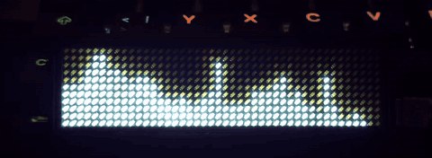
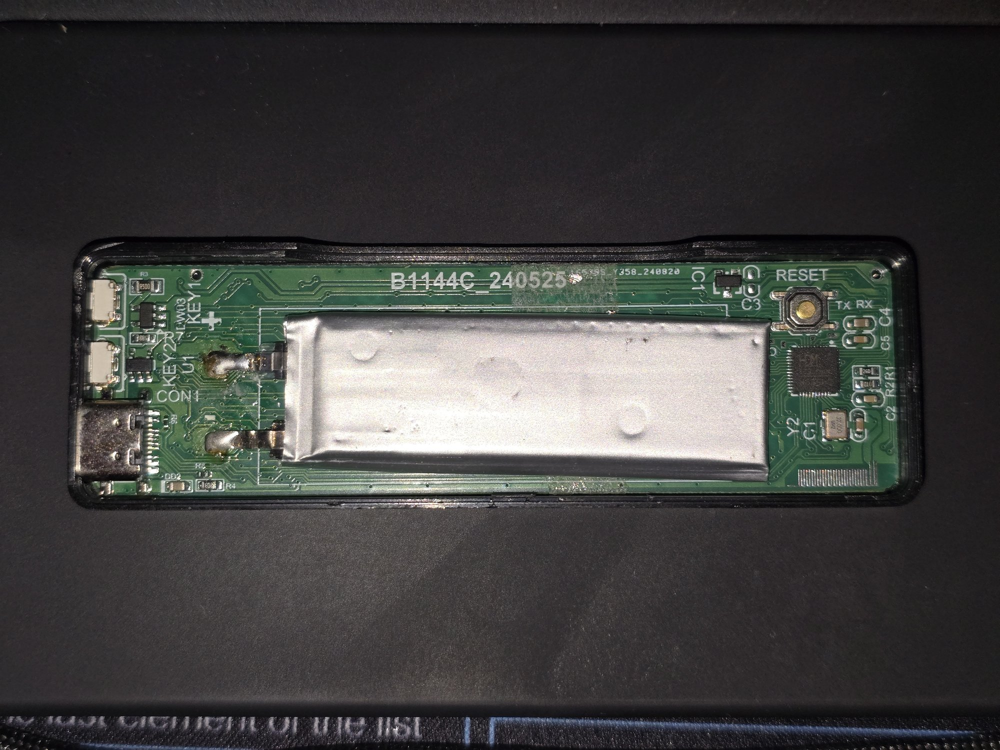
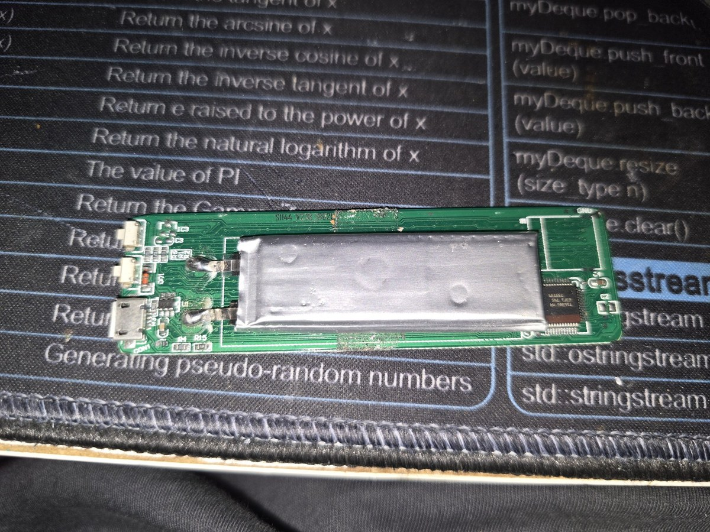
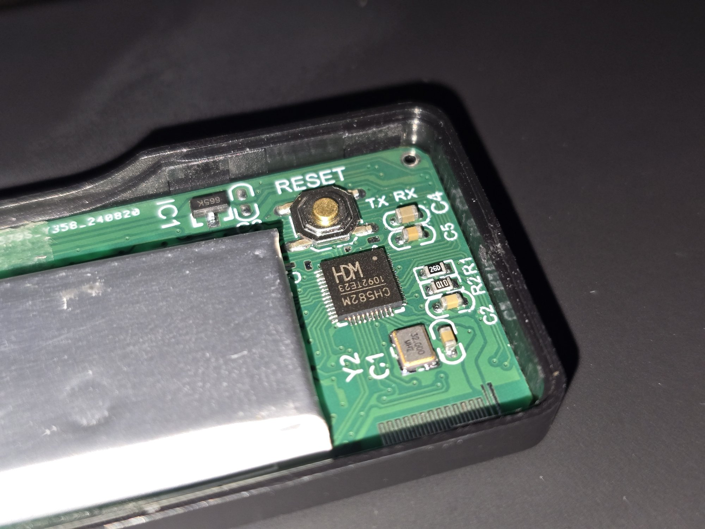
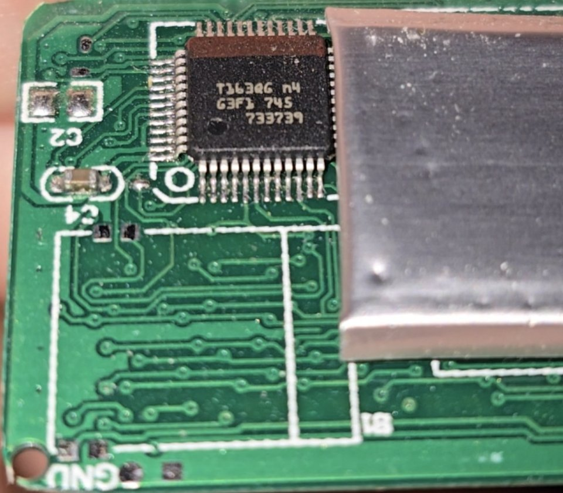
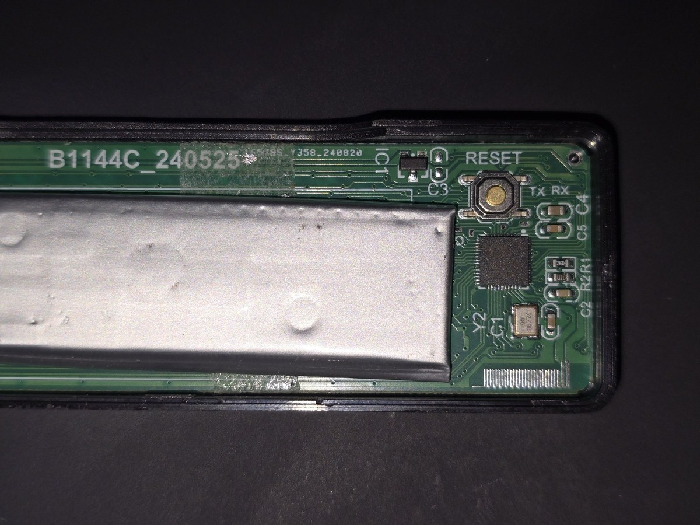
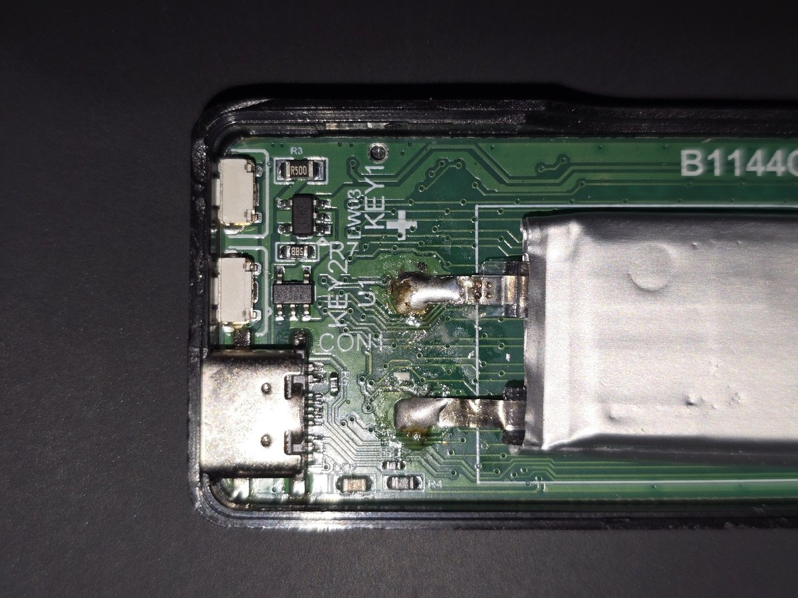
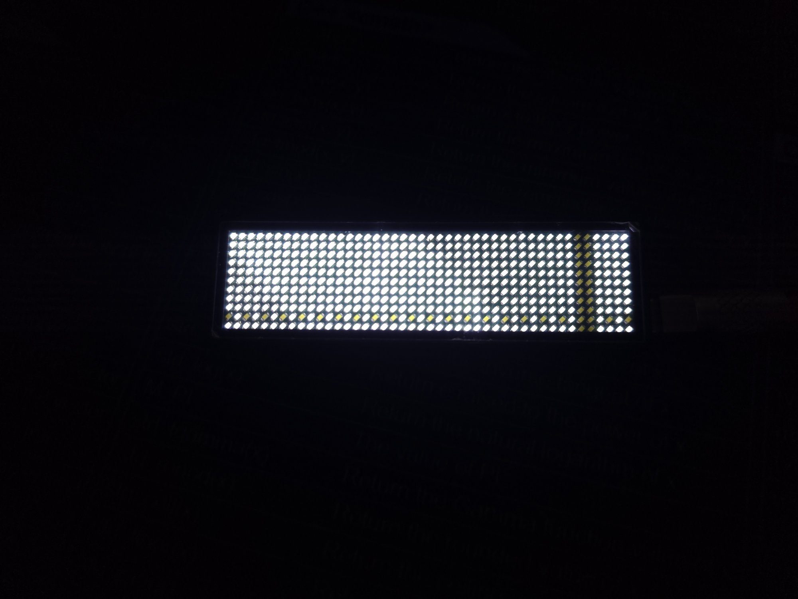
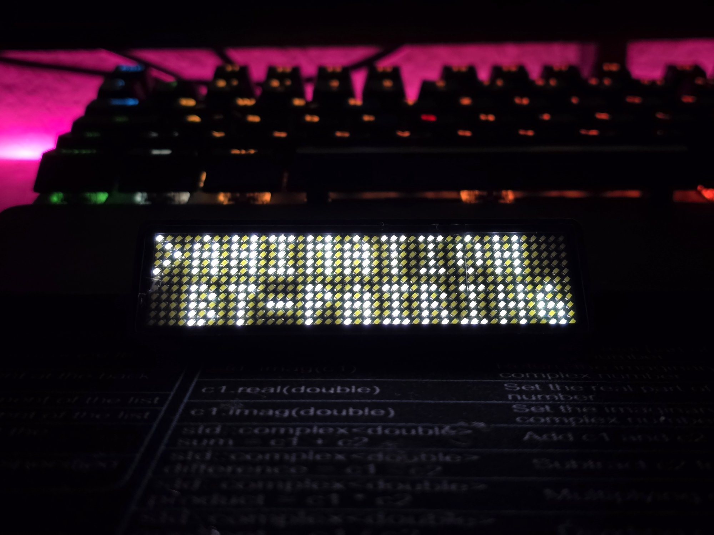
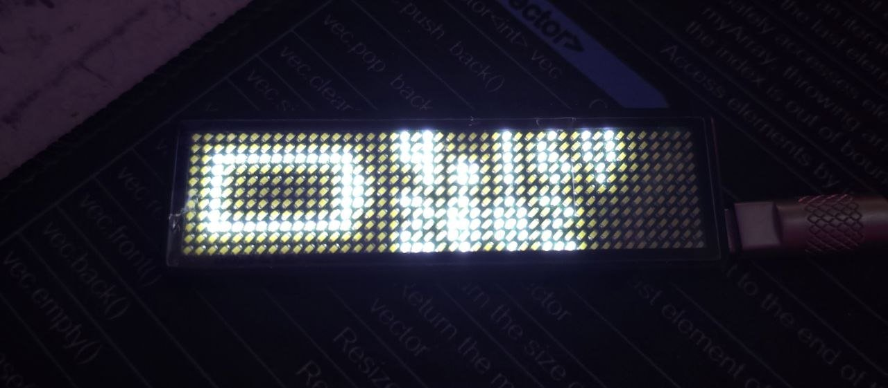

# badgemagic toolkit / custom firmware



> **A note before you dive in:** this is my take on these badges, the things I
> liked, wanted, and thought were cool to build. It is not a polished product
> or an official fork. Treat it as an example sketch to build on. That is also
> why all the small scripts from along the way are here, not just the finished
> tool.

A patched firmware and a Python tool for the cheap 44×11 LED name badges that
ship with the [Badge Magic](https://github.com/fossasia/badgemagic-app) app.

- The patched firmware is where most of the work went. Built on
  [fossasia/badgemagic-firmware](https://github.com/fossasia/badgemagic-firmware),
  it turns the badge into a 44×11 display you can stream to live, keeps
  Bluetooth reachable without touching the badge, puts a 6-digit PIN in front
  of it, and fixes a long list of display, storage, USB and UI bugs that only
  show up on real hardware. [What the patched firmware adds](#what-the-patched-firmware-adds)
  is the short version, [What was broken upstream](#what-was-broken-upstream)
  the long one.
- `badgetool.py` drives the badges from a PC over USB (HID or serial) and over
  Bluetooth: the clock, brightness, Bluetooth name, always-on mode and PIN, the
  battery voltage and chip temperature, text and image uploads, jumping to a
  slot, live streaming and firmware flashing, as commands or from an
  interactive menu.
  [What works over which connection](#what-works-over-which-connection)
  has the details.
- A [web panel](#web-panel-web) that needs nothing installed:
  **[open it here](https://timon-sys.github.io/badgemagic-toolkit/)** in
  Chrome or Edge, on a PC or an Android phone, and connect over USB or
  Bluetooth. Text slots with a live preview, a draw pad that mirrors itself
  onto the badge, images and the settings.
- `ls32/ls32_image.py` shows static images on the older LS32 badges.

## Contents

- [What the patched firmware adds](#what-the-patched-firmware-adds)
- [Does this fit my badge?](#does-this-fit-my-badge)
- [Getting started](#getting-started)
- [Bluetooth](#bluetooth)
- [Web panel](#web-panel-web)
- [Example scripts](#example-scripts-ng)
- [The patched firmware](#the-patched-firmware): flashing, what was broken, building
- [Protocol notes](#protocol-notes)
- [Ideas / not done yet](#ideas--not-done-yet)

## What the patched firmware adds

- Live streaming, the reason I started the project: the badge becomes a 44×11
  display you can drive from a PC at about 60 fps over USB and 20 to 30 fps
  over Bluetooth. Upstream had streaming over Bluetooth only. Try
  `badgetool.py stream picture.png`, or push frames from your own code the way
  [`ng/badge_display.py`](ng/badge_display.py) does.
- A display that does not flicker: about 91 Hz instead of upstream's 45 Hz,
  with no visible column sweep and no stray bright pixels while the badge
  redraws, saves or talks over Bluetooth.
- Bluetooth that is reachable without touching the badge, and a 6-digit PIN
  that keeps strangers out. See [Bluetooth](#bluetooth).
- A USB serial port that works on Windows too, at the same speed as HID.
- Uploads from the Badge Magic app work, with or without a PIN. Renaming the
  badge does not break the app either.
- Settings survive reboots and reflashes, and the clock survives reboots and
  switching off. It [drifts a lot](#ideas--not-done-yet), so set it now and
  then with `badgetool.py time`.
- The charging screen shows the battery voltage and gets out of the way after
  5 seconds instead of waiting for a button press forever (or waits for one,
  if you prefer: `badgetool.py charging-screen button`). With the startup
  animation off as well, the badge boots straight to your slots.
- Calmer buttons: the button nearest USB steps one slot per press instead of
  starting an automatic cycle, a long press on the other button changes
  brightness, and a long press on the button nearest USB opens the menu.
- Remote control without buttons: `badgetool.py slot 3` jumps to slot 3 from
  wherever the badge is (clock, menu, BT-PAIRING), and `status` tells you
  everything, voltage and clock included, over USB and Bluetooth alike.
- A thermometer you didn't know you had: the CH582 has a temperature sensor on
  its own die, and since 1.6.0 `battery` and `status` read it. The firmware
  takes 16 samples and converts their sum against the calibration point
  (nominally 25 °C) that WCH burns into every chip's ROM. One degree is only
  2.7 ADC counts, so converting the sum instead of the average is what gets
  the readings down to 0.1 °C steps. Read it as a trend: one factory point is
  all the calibration there is, and it measures the chip, not the room.
- A battery that doesn't get run flat: since 1.6.1 the badge checks its
  battery every 30 seconds, and after three readings in a row under 3.3 V
  (0 % on its own scale) it shows the empty-battery warning for 2 seconds and
  switches itself off. The button or a charger switches it back on. The
  threshold is fixed in the firmware. The check pauses while charging, and
  the first one comes 30 seconds after switching on, so a badge on an empty
  battery stays up long enough to plug in or flash. Tested on a drained badge:
  streaming full white at full brightness, it showed the warning and switched
  off about 2 minutes after the charger came off.

The full list of upstream bugs this fixes is under
[What was broken upstream](#what-was-broken-upstream).

## Does this fit my badge?

These badges are sold under many names, in different case and LED colours, so
the look does not tell you much. What matters is the chip inside.
`badgetool.py list` tells you which kind is plugged in by its USB name:

| Badge | USB name | What works |
|---|---|---|
| CH582, patched firmware | "FOSSASIA WAS HERE" | everything |
| CH582, factory firmware | "wch.cn" / "CH583" | text and images (USB and BLE) |
| LS32 (older, USB only) | "LS32 Custm HID" | text and images over USB |

You do not have to flash anything to get started. On a factory badge
`badgetool.py` uploads text and images over its original protocol, so you can
try the tool first and decide about the firmware later.

All three kinds show up as USB device `0416:5020` and share the legacy "wang"
upload format, the same one the app uses. Only the patched firmware also speaks
the `ng` protocol, which handles settings, status, the clock and streaming. If
`list` says `unknown`, please open an issue with its output (it prints the USB
strings).

| CH582 badge (USB-C, 2 buttons) | LS32 badge (micro-USB) |
|---|---|
|  |  |
|  |  |

The CH582 board in these pictures is revision `B1144C_240525`. Look for the
`CH582M` marking on the chip.

### What works over which connection

With the patched firmware, this is the whole picture.

| | USB HID | USB serial | Bluetooth |
|---|---|---|---|
| Text and image uploads | yes | yes | yes |
| Live streaming | ~60 fps | ~60 fps | 20 to 30 fps on `fastble` builds, about 4 fps otherwise ([details](#streaming-speed)) |
| Settings (clock, brightness, name, always-on, splash, charging screen) | yes | yes | yes |
| Full status and battery voltage | yes | yes | yes (firmware 1.5.0 and later; before that the battery percentage and firmware version only) |
| Chip temperature | yes (firmware 1.6.0 and later) | yes (1.6.0 and later) | yes (1.6.0 and later) |
| Jump to a slot (`slot N`) | yes | yes | yes (firmware 1.5.0 and later) |
| PIN settings (`security`, `pin`, `forget-bonds`) | yes | yes | no, by design |
| Flashing firmware | ISP mode only | no | no |

A factory-firmware badge takes text and image uploads over USB and Bluetooth,
and nothing else. An LS32 badge takes them over USB only.

## Getting started

### Requirements

- Python 3.11 or newer (for `tomllib`)
- `pip install -r requirements.txt` ([the list](requirements.txt)), or only
  what you use: `hidapi` for USB HID (the default), `pyserial` for `--serial`,
  `bleak` for Bluetooth, `pillow` for images
- Windows, Linux or macOS. I develop and test on Windows 11; USB serial was
  also tested on Ubuntu 26.04. On Linux, install
  [`linux/99-badgemagic.rules`](linux/99-badgemagic.rules) (instructions
  inside) to use the badge without `sudo`. It also keeps ModemManager away from
  the serial port, whose probing would garble the commands. Only the
  serial-port rule is tested so far; the HID and ISP rules are untested.

### Quick start

```sh
python badgetool.py                 # interactive menu: pick USB HID / serial / BLE, then a badge
python badgetool.py list            # badges on USB
python badgetool.py status          # everything the badge reports
python badgetool.py text "Hello" "Second slot" --mode center
```

### Commands

| Command | What it does |
|---|---|
| `list` | badges on USB (and their serial ports), or in range with `--ble` |
| `status` | mode, clock, brightness, Bluetooth settings, battery, chip temperature |
| `battery [-w SECONDS]` | voltage, raw ADC value, charging state and chip temperature, optionally refreshed |
| `time` | sets the badge clock to the PC time |
| `slot [N]` | shows slot N (1-8) now, leaving the clock, menu or BT-PAIRING; the button steps on from there. Without N: which slots are filled |
| `brightness 0-3` | 3 = brightest. 0 flickers slightly, by design |
| `ble on\|off` | always-on Bluetooth (badge reboots) |
| `name "NAME"` | Bluetooth name, max 20 characters (badge reboots) |
| `splash on\|off` | startup animation |
| `charging-screen 0-60\|button` | seconds the charging screen shows at boot (default 5); 0 boots straight to the slots, `button` waits for a button press (Bluetooth stays off until then; firmware 1.5.0) |
| `security on\|off` | on = Bluetooth devices must pair with the PIN; USB only, see [Pairing and the PIN](#pairing-and-the-pin) |
| `pin [NNNNNN\|random]` | shows the PIN and how many devices are paired, or sets a new one (which removes every pairing); USB only |
| `forget-bonds` | removes every paired device; USB only |
| `pair --ble` / `unpair --ble` | pairs this PC with the badge / removes the pairing (Windows) |
| `text MSG [MSG ...]` | one message per slot; options `--mode --speed --blink --border --font thin\|app --preview` |
| `upload config.toml` | a full Badge Magic config file (see below) |
| `image pic.png [--invert]` | static image in slot 1; dark pixels light up, `--invert` for light ones |
| `stream white\|off\|pic.png` | live picture without touching the slots |
| `reset` / `off` | reboot / power off |
| `flash normal` / `pb6` / `normal-fastble` / `pb6-fastble` / `FILE.bin` | flashes the patched firmware (badge in ISP mode, see [Which file](#which-file)) |

Scroll modes are `left`, `right`, `up`, `down`, `center`, `fast`, `drop`,
`curtain` and `laser`; speed goes from 0 to 7. Which commands need USB is in
[the connection table](#what-works-over-which-connection).

### Choosing a badge

```sh
python badgetool.py status -i 1                      # second badge on USB
python badgetool.py status --ble                     # scan and pick
python badgetool.py status --ble AA:BB:CC:DD:EE:FF   # by Bluetooth address
python badgetool.py status --ble 11-22-33-44-55-66-77-88   # by chip UID (as wchisp prints it)
python badgetool.py status --serial                  # USB serial, port found automatically
python badgetool.py status --serial COM36            # or /dev/ttyACM0
```

The options also work after the command (`badgetool.py text Hi --ble`).

Over USB serial everything works as it does over HID, including `status`,
`battery` and the reboots (the tool waits for the port to come back). It needs
the patched firmware 1.3.0 or later, which `status` shows as
`v0.1-toolkit-1.3.0` or higher. The builds in `firmware/` are all newer than
that, so this only matters if a badge still runs one of the pre-1.3.0 builds,
which show `v0.1-64-gb2137f0-dirty`: Windows could not open their serial port
at all, and on Linux they never answered `status` or `battery`. Reflashing
fixes it.

A badge that is connected over Bluetooth stops advertising, so close other BLE
sessions (the interactive menu, the phone app, a web panel tab) before you
scan.

### Your slots: config.toml

Your slots live in `config.toml`, which comes with eight example messages, one
for every scroll effect except `fast`. Edit it, then run `python badgetool.py
upload config.toml` or use the menu. The format is the same as the official
`badgemagic` CLI's:

```toml
[[message]]
text = "HELLO"
mode = "center"

[[message]]
text = "scrolling text"
mode = "left"
speed = 6
border = false
blink = false
```

A message can show a picture instead of text with `image = "pic.png"`: the path
is relative to the config file, the picture is scaled to 11 rows, dark pixels
light up, and `invert = true` turns that around. Use `mode = "center"` for a
still picture. Or draw it right in the file with `pixels`, one line per row,
`#` for a lit LED and any other character for a dark one, up to 11 rows (fewer
are centred vertically):

```toml
[[message]]
mode = "center"
pixels = '''
.#.#.
#####
.###.
..#..
'''
```

Text and pictures are the same thing to the badge. A slot is nothing but a
bitmap, 11 rows tall and as wide as you like, plus its scroll mode and speed.
The badge has no font and never draws your text itself: `badgetool.py`, the
phone app and the web panel all render the letters into a bitmap on their side
and upload the pixels. That is why a slot can hold a picture at all, why the
font is a choice of the sender (`--font thin` or `--font app`), and why the
badge cannot shorten or re-wrap a message it is showing.

Eight messages is the maximum. A `brightness` line from the official CLI's
files is ignored; use `badgetool.py brightness` instead. Files saved with a
UTF-8 BOM (by PowerShell, for example) are read correctly.

Text is rendered on the PC in the same thin font the official `badgemagic` CLI
uses, so it looks the same over USB and Bluetooth. `--font app` switches to the
phone app's thicker 8×11 font.

## Bluetooth

### Always-on advertising

Upstream, the badge is only visible over Bluetooth while you sit in the
BT-PAIRING menu, and its "always on" setting never actually switched
advertising on. With the patched firmware and always-on enabled (the default),
the badge advertises from the moment it starts, every 60 to 125 ms, while it
shows your slots, the clock or anything else. The phone app or `badgetool.py
--ble` can connect at any time without you touching the badge.

Switch it with `python badgetool.py ble on` or `ble off`; the badge reboots to
apply it.

With always-on turned off, the badge is only visible while you are in the
BT-PAIRING menu. It goes quiet once an upload finishes or you leave the menu.
Anything still connected at that point keeps its connection until it closes,
and the badge does not advertise afterwards.

While something is connected the badge stops advertising, because it only takes
one connection at a time. If a scan does not find it, close the other connection:
the phone app, a web panel tab, or the `badgetool.py` menu, which holds its
connection until you quit it.

Always-on costs some battery even when nothing is connected. How much is not
measured yet, so turn it off for long days away from a charger.

With security off, anyone in range can control the badge: stream to it, upload
slots, change the brightness, the name or the clock, reboot it or switch it
off. Switch on the PIN, or keep always-on off so the badge is only reachable
while you are in the BT-PAIRING menu.

The Bluetooth name shows up in scans, and the app finds badges by their service
ID rather than by name, so any name keeps working with the app.

### Pairing and the PIN

**The PIN is 123456 until you change it.** `badgetool.py pin` over USB prints
the current one, and the badge shows it in its BT-PAIRING menu while security
is on.

With security on (firmware 1.4.0 or later), a device has to pair with the
badge's 6-digit PIN before it can send anything over Bluetooth: no slot
uploads, no commands, no streaming. Only the battery level and the device info
stay readable. Each device types the PIN once, the badge remembers it as a
bond, and later connections need no PIN. USB is never affected, and the PIN and
the security switch can only be changed over USB.

```
python badgetool.py pin 246813      # or: pin random; 'pin' alone shows it and how many devices are paired
python badgetool.py security on     # saved and applied at once, no reboot
python badgetool.py pair --ble      # on Windows: brings up the pairing notification
```

On Windows, an unpaired PC that connects makes the badge ask for pairing, and
Windows shows an "Add device" notification. Click it and type the PIN.
`badgetool.py pair --ble` connects and holds the link open so that the
notification appears, so run it, then answer the notification.

If Windows then says "connection error", the connection that raised the
notification had already closed before you typed the PIN. Pairing the badge
from Windows itself works every time in that case: Settings, Bluetooth and
devices, Add device, Bluetooth, then pick the badge. The pairing belongs to
Windows either way, which is why it also shows up in that device list, and why
`badgetool.py unpair --ble` is just a shortcut for removing it there. The badge
keeps its own half of the pairing until you run `forget-bonds` or change the
PIN.

On Android, the web panel and the Badge Magic app both ask for the PIN by
themselves, and both work with security on. iPhones should behave the same way
but are untested, as is pairing from Linux with `bluetoothctl` (`pair ADDRESS`,
then the PIN).

On the badge itself, the SECURITY menu switches the PIN on and off, and
BT-PAIRING shows it while security is on. While you are in BT-PAIRING, a long
press of the button away from USB (KEY4 on 4-button badges) lets the next
device in without the PIN, until you leave the menu.

Changing the PIN removes every pairing, so all devices pair again with the new
one. Remove the badge from their Bluetooth settings first, or their old pairing
keeps failing. `badgetool.py forget-bonds` removes all pairings without
changing the PIN.

The badge stores two bonds, say a PC and a phone. Pairing a third device makes
it forget all pairings, which is how WCH's Bluetooth library handles a full
store. On a badge that held two bonds, pairing one more device left it
reporting exactly one, so both earlier bonds were gone.

When the badge has forgotten a device (third device, new PIN, `forget-bonds`),
that device still keeps its half of the pairing and fails to connect with
"operation canceled" on Windows, without asking for the PIN. Remove the badge
from its Bluetooth list, then pair again.

The other way round, when the device has forgotten the badge (you removed it
from Windows' Bluetooth list, or a reinstall did), nothing looks broken at
first. Scanning and connecting still work, and so do the battery level and the
device info, so `badgetool.py status --ble` keeps printing the battery. Only
writes and notifications fail, with "insufficient authentication" (ATT error
5), so streaming and commands quietly do nothing. Pair again, and remember that
it counts as a new device in the two-bond store above.

How secure is it? Set your own PIN first, since every badge ships with the same
default. Guessing costs
one full pairing per try, and devices that pair without the PIN ("Just Works")
are refused and forgotten. Someone who records a pairing over the air can work
out the PIN afterwards, though, because Bluetooth passkeys are not made to stay
secret when they are reused. So pair where nobody is listening in, or set a new
PIN afterwards. The `fastble` builds pair with LE Secure Connections, so a
recorded pairing does not let anyone decrypt the traffic that follows; the
other builds lack the buffer space for that and use legacy pairing, where it
does.

### Streaming speed

The numbers here come from [`ng/ble_fps.py`](ng/ble_fps.py) with writes without
response, on one badge with a `fastble` build: 20 to 30 fps, and 13 to 23 fps
with nearly every LED lit, because lit LEDs disturb the badge's own radio (see
[What was broken upstream](#what-was-broken-upstream)). With confirmed writes,
where every frame waits for the badge's answer, expect 5 to 6 fps in that worst
case. No frames were lost and no link dropped in any of those runs.

Where in those ranges you land varies between runs. Distance hardly matters
until you really walk away from the badge, and then it only gets a little
worse.

The standard builds manage about 4 fps, and upstream's firmware about 2 fps.
Over USB it is about 60 fps regardless.

## Web panel (`web/`)

**Live at <https://timon-sys.github.io/badgemagic-toolkit/>**, always the
version on `main` (GitHub Pages, published by
[`.github/workflows/pages.yml`](.github/workflows/pages.yml)).

`web/index.html` is a control panel that runs in the browser, with no Python
needed: open it in Chrome or Edge and connect over USB HID (WebHID, desktop only),
USB serial (Web Serial, desktop; firmware 1.3.0 or later) or Bluetooth (Web
Bluetooth, desktop and Android). It does text slots with a
live preview of the scroll modes, a 44×11 draw pad that can mirror itself live
onto the badge, images, the settings, reboot and power off. A keep-alive ping
notices a lost badge within a few seconds and reconnects, and a TX/RX monitor
shows every packet. Over USB it also sets the
[PIN](#pairing-and-the-pin). It shows the chip temperature next to the
battery (firmware 1.6.0, over all three connections) and sets the charging
screen (firmware 1.3.0 and later).

Both browser APIs need a secure context: `localhost`, a `file://` page or
`https://`. The GitHub Pages copy is HTTPS, so it works from a phone as it
is. The panel is a single file, so you can also put `index.html` on your own
web server with HTTPS. A self-signed certificate is fine: click through the
warning once and Web Bluetooth works. Factory-firmware
badges get text and images only. Over Bluetooth, firmware 1.5.0 shows the full
status (voltage, clock, settings) like USB does; older firmware shows only the
battery percentage and firmware version, as `badgetool.py` does. Below the
messages, "Show on the badge now" jumps to a slot (empty slots are greyed out;
firmware 1.5.0 and later).

`index.html` is built from `panel.src.html` by `python build.py`, which copies
the fonts out of `badgetool.py`. Edit the source, then rebuild.

## Example scripts (`ng/`)

Small standalone scripts from the development of the firmware, handy as
protocol examples. `badgetool.py` does all of it too, so for normal use you do
not need them. Read a script before running it: several change and save
settings, and some reboot the badge. They only work with the patched firmware.

| Script | What it does |
|---|---|
| `badge_ng.py` | minimal `ng` client over USB HID or serial, plus `ble_find()`; `HidBadge.paths()` for several badges |
| `badge_display.py` | push PIL images to the badge as a live 44×11 display |
| `test_stream.py` | streaming test patterns, measures USB frame rate (~60 fps) |
| `test_serial.py` | the same over USB serial; optional port argument |
| `screen_mirror.py` | Windows only: mirrors the screen (or the area around the mouse) live; several badges stack into one taller display. All options are in `CONFIG` at the top and on the command line |
| `audio_viz.py` | Windows only: live spectrum of whatever the PC plays (the banner at the top), captured from the speaker output, not the microphone; several badges stack into taller bars. Options in `CONFIG` and on the command line; needs `pip install numpy soundcard` |
| `battery.py`, `set_time.py`, `set_brightness.py` | single settings over USB |
| `ble_always_on.py`, `fix_alwayson.py`, `apply_cfg.py` | config + reboot (`apply_cfg.py` resets to defaults, including the name) |
| `ble_check.py` | connect over BLE and list services; optional address argument |
| `ble_fps.py`, `ble_ng_test.py` | BLE streaming speed (`ble_fps.py --invert` is the worst case with nearly every LED lit, `--csv` logs every frame) and `ng` commands over BLE (`ble_ng_test.py` leaves brightness at 3 until the next reboot) |

## The patched firmware

### Before you flash

- There is no way back to the factory firmware. It is read-protected, so it
  cannot be backed up; only the settings memory can. The patched firmware does
  everything the factory one does and works with the Badge Magic app.
- The first time into ISP mode can be fiddly. On factory firmware the chip has
  to lose power completely, and the battery is soldered on, so that means some
  soldering or upstream's capacitor trick (see [Flashing](#flashing)). After
  that, the patched firmware enters ISP mode with a 2 to 3 second button press.
- A failed or wrong flash can be redone. The ISP bootloader sits in its own
  protected area of the chip that flashing does not touch. If the badge shows
  garbage or nothing at all after a flash, enter ISP mode again and flash the
  right file.
- Only CH582M badges with 44 columns. Some badges look the same outside but
  have another chip or a 48 or 55 column matrix. If in doubt, open the case and
  read the chip marking; upstream's
  [CH582.md](https://github.com/fossasia/badgemagic-firmware/blob/master/CH582.md)
  has photos.
- The files here are for the 2-button USB-C version only, the only one these
  patches were tested on. Upstream also supports 4 buttons and the older
  micro-USB boards (`KEY_COUNT=4`, `HARDWARE_REV1=1`), which you can build from
  source (see [Building](#building)), but they are untested with these patches.
- `badgetool.py flash` runs `wchisp config reset` first, like upstream's
  instructions do. Factory badges ship with read-out protection on and
  debugging off, and this writes WCH's default option bytes (no protection,
  debug enabled, reset pin on) so that the flash write and verify are allowed.
  It changes nothing else.

### Which file

Ready-to-flash builds are in [`firmware/`](firmware/), with checksums in
[`firmware/SHA256SUMS`](firmware/SHA256SUMS) (`sha256sum -c SHA256SUMS`). They
are also attached to the
[releases](https://github.com/Timon-sys/badgemagic-toolkit/releases).

Two choices make four files. The first is the LED wiring: `normal` for most
boards, `pb6` for boards where LED line T is wired to PB6. Not sure? Flash
`normal` first. If two columns stay dark and the second-to-last row flickers
(there is a picture under
[What was broken upstream](#what-was-broken-upstream)), flash `pb6`. Nothing
breaks either way.

The second is Bluetooth speed. The `fastble` builds ask for a 15 to 30 ms
connection interval and use a bigger packet size (MTU 96), which is what lifts
live streaming from about 4 fps to 20 to 30 fps. That costs more battery, but
only while something is connected. Uploads, the phone app and everything else
behave the same in both, except for how they pair with the
[PIN](#pairing-and-the-pin): Secure Connections on `fastble`, legacy pairing
otherwise.

| File | `flash` name | LED wiring | Bluetooth | Tested on a badge |
|---|---|---|---|---|
| `badgemagic-ch582-2key.bin` | `normal` | normal | standard | ran on a PB6 board (all but line T); upstream-wired board untested |
| `badgemagic-ch582-2key-pb6.bin` | `pb6` | PB6 | standard | yes: USB HID, serial and Bluetooth (every command; streaming 4 fps, 150/150 frames); v1.4.0 with the PIN on: every command over USB and Bluetooth, legacy pairing from Windows |
| `badgemagic-ch582-2key-fastble.bin` | `normal-fastble` | normal | fast | same code as `pb6-fastble` but the LED pin; upstream-wired board untested |
| `badgemagic-ch582-2key-pb6-fastble.bin` | `pb6-fastble` | PB6 | fast | yes: USB HID, serial and Bluetooth (every command; streaming 20 to 30 fps, 13 to 23 fps with nearly every LED lit, 300/300 frames); the phone app on two badges; pairing with the PIN from Windows, Android and the app; the web panel over all three connections. Since 1.5.0 an automated test script runs every command over USB HID, serial and Bluetooth before each release |

The `normal` builds ran for weeks on my badges (an earlier version), and
everything worked except the LEDs on line T, because both my badges are wired
to PB6. What I could not test is a board actually wired the upstream way, where
`normal` should show the whole display. If you have one, please
[open an issue](https://github.com/Timon-sys/badgemagic-toolkit/issues) and say
whether it worked.

### Flashing

1. Get [wchisp](https://github.com/ch32-rs/wchisp/releases) and put it in
   `tools/` (`tools/wchisp-win-x64/` works too) or anywhere on your `PATH`.
2. One-time setup. On Windows, the first time a badge is in ISP mode, use
   [Zadig](https://zadig.akeo.ie/) to install WinUSB for `4348:55E0`. On Linux,
   install [`linux/99-badgemagic.rules`](linux/99-badgemagic.rules)
   (instructions inside), so neither the tool nor wchisp needs `sudo`.
3. Run `python badgetool.py flash NAME`, with one of the `flash` names from the
   table above (`pb6-fastble`, for example). It waits up to 5 minutes for a
   badge in ISP mode.
4. Enter ISP mode, which differs depending on what is on the badge (see below).
   ISP mode shows a single lit pixel near the middle and lasts about 10
   seconds, and `badgetool.py` starts flashing as soon as it sees the badge.
5. The tool flashes, verifies, waits for the badge to reboot and sets its clock.

**With the patched firmware already on it,** which is every flash after the
first: hold the button nearest the USB port for 2 to 3 seconds while the badge
is connected over USB. You do not have to replug it or open the case. On the
way it may jump to the menu; keep holding.

**On factory firmware,** the hard part, and only once: the chip has to start up
from no power at all while you hold the button nearest the USB port. Switching
the badge off is not enough, because the soldered-on battery keeps the chip
powered. There are two ways in. The clean one is to desolder one battery lead,
plug in USB with the button held, flash, and solder the lead back. Upstream's
quicker method is to briefly short capacitor `C3` with tweezers or a wire,
again with USB connected and the button held. `C3` sits on the power rail, so
the short drops the voltage far enough to reset the chip, a "dirty power
cycle". Upstream calls it less reliable than removing the battery, and shorting
a neighbouring part by accident can damage the board, so it is not for
beginners. On the revision in the picture below (`B1144C_240525`) `C3` is next
to the RESET button; on other revisions it sits elsewhere. Upstream's
[CH582.md](https://github.com/fossasia/badgemagic-firmware/blob/master/CH582.md)
has the details.

The RESET button does not work for this. Holding the button and pressing RESET
only restarts the firmware, which I tried: it resets the chip without cutting
power, and the boot pin is only checked on a real power-up.

> **Never short the battery itself.** I got one badge into ISP mode by shorting
> it for a split second while holding the button. It worked, but a shorted LiPo
> cell can overheat, catch fire or burst. Use one of the methods above.

| C3 and RESET | KEY2 (nearest USB) and the soldered battery leads |
|---|---|
|  |  |

wchisp only rewrites the program flash, so in my tests the slots, settings and
Bluetooth pairings survived a reflash. The first flash over factory firmware
starts with default settings, because this firmware stores them in a different
place than the factory one.

### What was broken upstream

Everything below was found on real hardware while building this, and the
patched firmware fixes it. The groups are display, USB, Bluetooth, settings and
storage, and the screens and buttons.

#### Display

- Refresh rate halved upstream: commit `4e556ab` switched the LED scan from 2
  to 4 phases per column (for 4 brightness levels), which doubled the steps per
  frame from 44 to 88 but kept the 4 kHz timer, so a frame took 22 ms (about
  45 Hz) and the scan was visible. The timer now runs at 8 kHz: 11 ms per
  frame, about 91 Hz.
- Dead columns and a flickering row: on some board revisions LED line T is
  wired to PB6 instead of the upstream pin. The symptom is two dark columns and
  the second-to-last row alternating between lit and dead. That is what the
  `pb6` build is for (`LED_T_PB6=1`).

  
- Random bright pixel blips while redrawing: the framebuffer is now locked
  while it is cleared and redrawn, including in the games.
- Bright blips when saving or during Bluetooth traffic: a flash write stalls the
  LED refresh, so the lit column stayed on for milliseconds. The matrix now
  goes dark during flash writes instead, for under a tenth of a second when the
  brightness changes. The LED timer also gets a higher interrupt priority than
  the radio and USB, so it is never held up by them.
- Full-width pictures blinked: slot widths come in 8-column blocks, so a
  44-column picture is stored as 48 columns. The still modes (fixed, up and
  down, drop, curtain, laser, animation) showed those 4 empty columns as a page
  of their own, and the display went dark every other page. A last page that is
  only padding is skipped now; one lit column on it keeps it.

#### USB

- `ng` commands only worked over Bluetooth. The USB HID and serial interfaces
  now feed the same command parser (framed as `'N' 'G' len16 payload`), and
  everything else still goes to the legacy upload, so the official CLI keeps
  working. This is what lets `badgetool.py` do everything over USB.
- The USB serial port was unusable on Windows: the firmware ignored the
  requests a host sends when it opens a COM port (`SET_LINE_CODING`,
  `GET_LINE_CODING`, `SET_CONTROL_LINE_STATE`), so Windows failed the open with
  error 31. They are answered now, and the baud rate is stored and ignored. On
  top of that, the serial data endpoint had the same zero-length-IN bug as HID,
  `status` and `battery` replies only ever went out over HID, frames packed
  back to back in one USB packet lost their tail, and every setup packet was
  handled twice. Serial streaming now runs as well as HID, on Windows and Linux
  (`ng/test_serial.py`).
- USB HID replies were dropped every other time: the OUT handler no longer arms
  a zero-length IN, which had knocked the data toggle out of step.
- USB upload state was never reset: `legacy_usb_rx()` did not reset its length
  counters after a transfer, so a following upload could be misread.

#### Bluetooth

- Phone app uploads were rejected. The legacy BLE upload refused data as "not
  authed" unless the PIN feature was switched on (upstream issues #190 and
  #198). Version 1.4.0 replaced that PIN altogether, see below.
- The old SECURITY PIN protected little: a random 4-digit code, sent as plain
  text over Bluetooth, that only guarded slot uploads while every `ng` command
  stayed open. 1.4.0 uses Bluetooth pairing instead (see
  [Pairing and the PIN](#pairing-and-the-pin)). Apps that still send the old
  code before an upload keep working, and the code is skipped.
- Always-on Bluetooth did nothing: advertising was only ever enabled by the
  BT-PAIRING menu, so the setting could only switch off something that was
  already off. It is enabled at startup now, and always-on is the default.
- Bluetooth stayed on after BT-PAIRING: every disconnect switched advertising
  back on, so after one visit to the menu the badge stayed visible until the
  next reboot, even with always-on off. It now only advertises again if
  always-on is on or you are still in BT-PAIRING.
- "Breathing" and dropped links: the LED timer ticks every 125 µs, and every
  Bluetooth connection interval is a multiple of 1.25 ms, so the radio events
  kept landing on the same point of the LED cycle and only drifted by the tiny
  crystal difference between badge and PC. Each time they drifted across the
  LED switching, packets got lost for seconds: streaming sped up and slowed
  down every 13 to 19 seconds (each badge has its own period), and with many
  LEDs lit the link dropped. The LED timer period now varies by up to 2 % per
  tick, which you cannot see, so the interference is spread evenly. The
  `fastble` builds also ask for a 4-second supervision timeout instead of 1
  second. With nearly every LED lit, streaming with confirmed writes now runs
  at a steady 5 to 6 fps instead of 1.5 fps with dropped links.
- Slow Bluetooth, on the `fastble` builds: the badge allowed connection
  intervals up to 625 ms and never asked for less, because its request went to
  the wrong connection; the MTU of 64 split every 89-byte stream frame into a
  3-round-trip write; and the `ng` characteristic did not allow writes without
  response. It now asks for 15 to 30 ms after connecting, uses MTU 96 and
  accepts write-without-response, which took live streaming from about 4 fps to
  20 to 30 fps.
- A crash under load: `ng_notify()` freed the notification buffer even after
  the Bluetooth stack had taken it over. That double free corrupted the
  Bluetooth heap, and with notifications on and frames streamed fast, the
  badge's Bluetooth and buttons froze.
- A crash on `splash` over Bluetooth: upstream's splash-speed command, which is
  what `badgetool.py splash` sets, read its 16-bit value through a pointer that
  is odd-aligned when the command comes over Bluetooth. This core faults on
  misaligned loads, so the badge reset and lost its clock every time. Over USB
  the buffer happened to be aligned. It reads the two bytes separately now.
- The pairing menu left the BLE animation fighting with the menu when you left
  it.
- The standard Bluetooth battery level (what phones show) went to 254 % on an
  empty battery: under 3.3 V the percentage goes negative, and it was sent as
  a single unsigned byte. It stops at 0 % now.

  

#### Settings and storage

- Settings were lost or overlapped the game highscore. The config moved to
  `0x7C00`, it is erased before it is written and goes through an aligned
  buffer, and its CRC is seeded so that an all-zero block no longer counts as
  valid.
- The clock was lost on every boot. The RTC is only initialised when it holds
  no valid date, so the time survives reboots and a power-off with the button.
- A memory leak that crashed the badge: every time the slots were reloaded
  (after an upload, leaving the menu or BT-PAIRING), the pixel buffers of all
  slots were left allocated. A handful of reloads ran the heap dry and the badge
  crashed, rebooting with its clock reset to 2020. Found because jumping between
  slots reloads them every time: a few jumps in a row were enough.
- Fixing that leak uncovered the next crash: at the end of a USB upload the
  slots were reloaded from inside the USB interrupt, while the main loop could
  be drawing from those very buffers, now that they really get freed. The
  reload runs in the main loop now, and USB interrupts wait during it (a few
  milliseconds; the host retries), so the next upload's receive buffer and the
  slot buffers are never allocated at the same time. 100 uploads back to back
  and thousands of slot jumps per second run without a crash.

#### Screens, power and buttons

- Stuck on the charging animation when plugged in: the screen now leaves after
  5 seconds (adjustable with `badgetool.py charging-screen`, where `button`
  brings back the wait for a key press) or on a key press.
  It shows the battery voltage from the calibrated ADC instead of an animation,
  and the config is loaded before this screen, so a reboot while charging no
  longer saves zeros.

  
- Switching off while charging did not stick, and the badge came back on within
  a second. "Charging started" is a wake-up source, so that plugging in
  switches the badge on, and the charger signals it again once the badge stops
  drawing power. That wake-up is now only armed when the badge is not charging:
  switched off on battery, plugging in still switches it on; switched off while
  charging, it stays off until you press the button.
- LEDs stuck on after switching off: the LED timer kept running into power-off,
  leaving a column lit at full brightness. It is stopped first now.
- Slots cycled on their own: after the last slot, the button re-armed automatic
  cycling. Now it steps one slot per press and wraps around.
- The badge got stuck in the menu after an upload, behind a "BLUETOOTH OFF"
  screen. It shows the new slots straight away now, and boots into the slots
  instead of the menu.
- The Bluetooth animation came up after streaming: with always-on off, stopping
  a stream always brought up the BT-PAIRING animation, as if every stream had
  started there. It returns to your slots now, unless the badge really is in
  BT-PAIRING.
- Streaming and the clock fought each other: clock and stopwatch keep ticking
  while a stream is active but no longer draw over it, and the badge returns to
  the previous screen when the stream stops.
- The startup animation is off by default (`badgetool.py splash on` brings it
  back), so the badge is ready at once.

### Building

You do not need to build anything to use the files in `firmware/`. To build
them yourself, get upstream at commit `b2137f0` and apply
[`badgemagic-custom-patches.diff`](badgemagic-custom-patches.diff). For the
`fastble` builds, apply [`badgemagic-fast-ble.diff`](badgemagic-fast-ble.diff)
on top:

```sh
git clone https://github.com/fossasia/badgemagic-firmware
cd badgemagic-firmware
git checkout b2137f0
git apply ../badgemagic-custom-patches.diff
git apply ../badgemagic-fast-ble.diff       # only for the fastble builds
```

The toolchain is `riscv-none-embed-gcc` 8.2 (MounRiver / xPack) plus `make`, on
Linux, macOS or Windows (I use Git Bash). If the compiler is not on your
`PATH`, set `PREFIX` as upstream's README describes.

```sh
BUILD_DIR=usb-c-2key KEY_COUNT=2 make                  # normal build
BUILD_DIR=usb-c-2key-t6 KEY_COUNT=2 LED_T_PB6=1 make   # pb6 build
```

The version string comes from `TOOLKIT_VERSION` in the patched `Makefile`: the
firmware names itself after the toolkit release, so `status` and the Bluetooth
device info show `v0.1-toolkit-1.6.1` (upstream base, then the toolkit
version) instead of the git description, which was the same for every build
here. The result is `<BUILD_DIR>/badgemagic-ch582.bin`, and a clean checkout
with the patches builds byte-identical copies of the files in `firmware/`.
Flash it with `badgetool.py flash path/to/badgemagic-ch582.bin`.

## Protocol notes

| | USB HID (`0416:5020`, interface 0) | USB serial (interface 1) | BLE |
|---|---|---|---|
| Legacy upload | 64-byte reports | the packet as is, unpadded | service `fee0`, characteristic `fee1`, 16-byte writes |
| `ng` commands | `'N' 'G' len16 payload` in 64-byte reports | the same frames as a byte stream, no padding | service `f055`: write `f057`, notify `f056` |
| Replies (`STA`, `BAT`, `SLT`, `PIN`) | 64-byte IN report | 64 bytes on the port | `f056` notifications from 1.5.0 (`PIN`: never, it is USB only) |

Over serial the `ng` frames are a plain byte stream, packed back to back and
split across USB packets any way the host likes, with the replies on the same
port. Legacy uploads work over serial too. The port ignores
the baud rate, so any setting works.

`ng` commands are next packet (0), power (1), stream set (2), stream bitmap
(3), BLE settings (4), splash screen upload (5), save (6), load defaults (7)
and misc (8). The misc functions are splash speed, brightness, set time,
battery reply `BAT`, status reply `STA`, charging screen seconds, over USB
only: security on and off, the PIN (set it, or read the `PIN` reply with no
argument) and forget bonds, and since 1.5.0 show slot (9). The `PIN` reply is
`'P' 'I' 'N'`, the PIN as u32 little endian, security on, and the number of
bonds.

The `BAT` reply is `'B' 'A' 'T'`, the raw ADC value and the voltage in mV (both
u16 little endian), charging (0 or 1), then, since 1.6.0, the chip temperature
in tenths of a degree as an i16 and a 1 at byte 10 that says the temperature is
there. Older firmware leaves those bytes at zero.

Show slot takes the slot number 0 to 7 and leaves the clock, stopwatch, menu or
BT-PAIRING for the slots; with no argument it only asks. Either way it answers
`'S' 'L' 'T'`, the result (0 = done, `0xff` = slot empty, `0xfc` = busy with a
game, a stream or switched off) and a byte with bit N set for every filled
slot. That reply exists because USB has no ack for `ng` commands.

Over Bluetooth, the 64-byte replies arrive as `f056` notifications, followed
by the 1-byte ack every `ng` command gets. The `fastble` builds (MTU 96) send a
reply in one piece; with a smaller MTU it comes in equal parts of at least 2
bytes, so a client tells parts from acks by their length and joins them until
it has 64 bytes.

With security on, the characteristics `fee1`, `f057` and `f056` answer ATT
error 5 (insufficient authentication) until the link is paired with the PIN.
Bonds live in two data flash pages at `0x7A00`, just below the settings, and
the PIN starts at 123456.

The `STA` reply is layout 2 since 1.3.0: byte 63 holds the charging screen
seconds, and the version string before it is cut to 19 characters, so readers
of layout 1 (which stop at its NUL) keep working. The charging screen itself is
a setting from 0 to 254 seconds in the firmware, default 5, where 0 skips it
and 255 waits for a key press (before 1.5.0, 255 meant 255 seconds);
`badgetool.py charging-screen` takes 0 to 60 or `button`. Settings saved by
older builds are migrated when you update, so nothing resets.

The Badge Magic app finds badges by the advertised service `0xFEE0`, so
renaming a badge keeps it compatible with the app.

## Ideas / not done yet

- **Below brightness level 0.** The lowest setting is a 25 % duty cycle, which
  is the shortest on-time the LED timer can express: a column pair's window is
  4 ticks of 125 µs and level 0 releases the matrix after one of them. Waiting
  a few microseconds with `DelayUs()` inside `TMR0_IRQHandler` and releasing
  there instead gets below that, with the 91 Hz refresh unchanged; one badge ran
  5, 12, 25 and 50 % on its four levels, clearly darker and no extra flicker.
  Not shipped: it busy-waits about 5 % of the CPU in the interrupt that already
  outranks the radio, and four levels mean giving up 75 and 100 % to gain the
  dim end, so it really wants `BRIGHTNESS_LEVELS` 6.
- The Bluetooth PIN on an iPhone and from Linux (`bluetoothctl`) with security
  on. Tested so far: `pb6-fastble` from Windows, Android and the app, and `pb6`
  (legacy pairing) from Windows.
- Smoother BLE streaming: frames arrive on the connection-interval grid
  (Windows picks 30 ms), so streams at 15 or 20 fps jitter by a slot now and
  then. A 7.5 to 15 ms interval would smooth that out, at more battery cost
  while connected.
- The battery cost of always-on Bluetooth is not measured yet.
- Remote mode switching beyond slots: `slot N` brings the badge back to the
  slots from anywhere, but switching to the clock, stopwatch or menu from the
  PC still needs the buttons.
- Bluetooth replies on the standard builds (MTU 64) come in two parts; that
  path is tested with a simulated badge only, not on hardware.
- The clock drifts a lot, because the badge has no 32 kHz crystal and the clock
  runs on the chip's internal RC oscillator. Measured on one badge: about 10 %
  (1 s every 10 s), sometimes slow, sometimes fast, so after a few days without
  setting it the badge can be hours off. The calibration against the main
  crystal (`Calibration_LSI`) apparently does not hold. Set the clock with
  `badgetool.py time` when you need it; fixing it properly would mean
  recalibrating periodically or correcting the RTC in software.
- Upstream pull requests: several fixes (config storage, the HID reply bug, the
  USB serial port, the `splash` crash over Bluetooth, the slot memory leak,
  switching off while charging, `LED_T_PB6`, the blips, the charging screen)
  would be useful for FOSSASIA too.

## Credits and licences

- Made by me together with
  [Claude](https://claude.com/claude-code) (Anthropic's AI assistant): the
  firmware debugging, the patches, `badgetool.py` and this README were worked
  out in pair-programming sessions, with every change tested on real badges.
- This project is licensed under [Apache-2.0](LICENSE), the same as the
  firmware it is based on.
- Firmware: [FOSSASIA badgemagic-firmware](https://github.com/fossasia/badgemagic-firmware)
  (Apache-2.0). The patches and the builds in `firmware/` follow the same licence.
- Thin font: `u8g2_font_lucasfont_alternate_tf` from
  [u8g2](https://github.com/olikraus/u8g2) (Lucasfont Alternate © Patrick
  Lauke 2012, made with [FontStruct](https://fontstruct.com/fontstructors/145/redux)).
  This is the same font the [badgemagic-rs](https://github.com/fossasia/badgemagic-rs)
  CLI uses. Its licence is believed to be
  [CC BY 3.0](https://creativecommons.org/licenses/by/3.0/), like the author's
  other FontStructions, but the font's own page could not be found. If you know
  better, please open an issue.
- App font table: [FOSSASIA badgemagic-app](https://github.com/fossasia/badgemagic-app) (Apache-2.0).
- Flashing: [wchisp](https://github.com/ch32-rs/wchisp).
